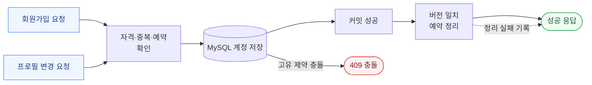
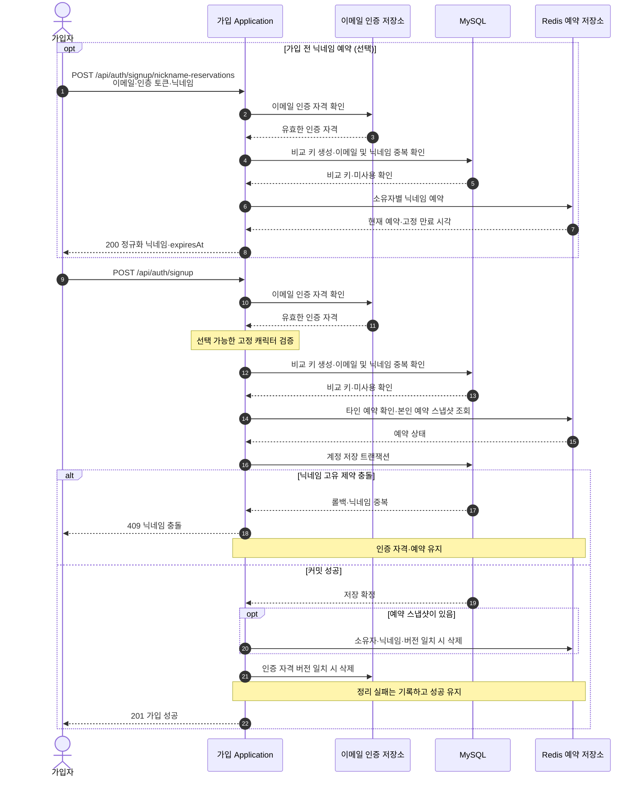
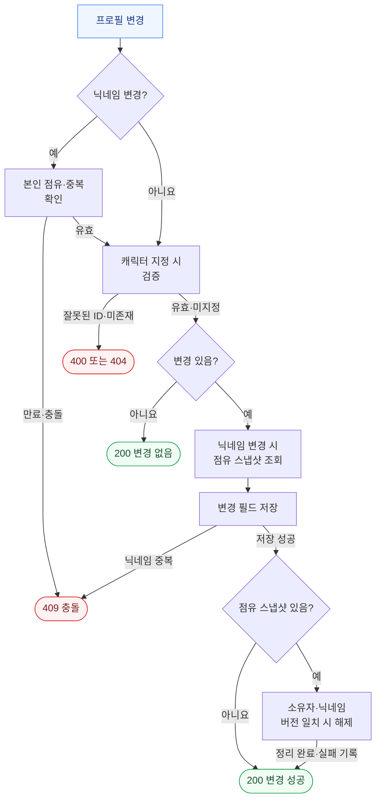
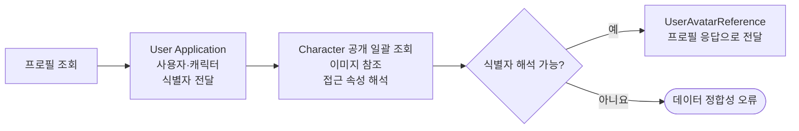

# 사용자 가입·프로필 처리 흐름

- Status: Active
- Audience: Backend Engineers
- Source of Truth: Yes
- Last Reviewed: 2026-10-15

## 목적

회원가입과 프로필 변경의 닉네임 예약, 최종 저장, 커밋 후 정리 및 캐릭터 참조 처리를 설명한다. 저장소 간 정합성과 Web·Application·Adapter의 책임을 다룬다.

## 전체 흐름

가입 예약은 선택 사항이며, 프로필의 닉네임 변경에는 본인 점유가 필요하다. 저장 실패 시에는 인증 자격·예약을 유지하고, 커밋 후 정리 실패 시에는 성공 응답을 유지한다.

## 책임 경계

- Web Adapter는 요청을 Application 유스케이스에 전달하고 성공 결과와 RFC 9457 Problem Details를 HTTP 응답으로 변환한다.
- Application은 입력 닉네임을 `Nickname` 값 객체로 변환한 뒤 중복 확인, 예약 소유권 검증과 계정 저장을 조율한다.
- 가입 예약은 `NicknameReservationStorePort`, 프로필 점유는 `NicknameHoldPort`를 사용한다. 프로필 점유 Adapter도 같은 예약 저장소에 위임하므로 가입과 프로필 요청이 서로의 예약을 확인한다.
- Redis Adapter는 가입과 프로필 변경이 함께 사용하는 예약 기록을 관리한다.
- `NicknameIdentityPort`의 MySQL Adapter가 닉네임 비교 키를 만들고, 계정 저장 Adapter가 최종 닉네임 고유성을 보장한다.

## 닉네임 식별과 공유 예약

- 표시 닉네임은 앞뒤 Unicode whitespace를 제거한 값을 사용한다. 대소문자나 중간 whitespace를 바꾸지 않는다.
- 예약 키는 MySQL의 `utf8mb4_0900_ai_ci` collation에 `WEIGHT_STRING`을 적용한 비교 값이다. 표시 문자열이 달라도 DB에서 같은 닉네임으로 비교되면 같은 예약 대상을 가리킨다.
- 가입 예약의 소유자는 정규화 이메일 해시의 `signup:` 식별자, 프로필 점유의 소유자는 사용자 ID의 `user:` 식별자로 구분한다.
- Redis에는 닉네임별 예약과 소유자별 현재 예약을 함께 저장한다. 각 기록에는 닉네임 비교 키, 표시 닉네임, 예약 버전과 만료 시각이 있고 닉네임별 기록에는 소유자도 포함한다.
- 두 기록은 동일한 Redis hash tag를 사용하며 Lua 연산으로 함께 생성·교체·조건부 삭제한다. 만료는 Redis 서버 시각을 기준으로 최초 생성부터 10분 뒤로 설정한다.
- 동일 소유자의 동일 예약 재요청은 기존 버전·표시 닉네임·만료 시각을 반환한다. 다른 닉네임의 예약에 성공하면 이전 예약을 해제하고 새 예약을 만든다.
- 현재 예약 조회는 소유자 기록 하나를 읽어 해당 시점의 스냅샷을 반환한다.
- 생성·교체 중 다른 요청이 먼저 예약을 변경하면 충돌로 처리한다. 필수 필드 누락이나 소유자·버전 불일치 등 손상된 기록은 덮어쓰지 않고 저장소 오류로 처리한다.

## 회원가입 예약과 저장

- 가입 예약은 이메일, 해당 이메일의 `emailVerificationToken`과 닉네임을 함께 확인한다. 유효하지 않은 자격이나 계정 중복·타인 예약은 저장 전에 거절한다.
- 가입 전 예약이 없어도 미예약·미사용 닉네임이면 가입할 수 있다.
- 예약 응답의 `expiresAt`은 Asia/Seoul 기준의 시간대 없는 날짜·시간 값이다.
- 가입 저장이 실패하면 이메일 인증 자격과 예약을 소비하지 않는다. 커밋 후에는 확인한 버전과 일치하는 기록만 정리한다.

## 프로필 변경

변경 전 `GET /api/users/nickname/availability`에서 현재 닉네임과 같으면 바로 성공한다. 새 닉네임이면 계정 중복을 확인하고 Redis에 본인 점유를 생성한다.

- 닉네임이 null이면 캐릭터만 변경할 수 있다. 빈 문자열이나 whitespace만 있는 닉네임은 캐릭터 변경이 함께 요청되어도 거절한다.
- 정규화 후 현재 닉네임과 같으면 새 점유를 요구하지 않는다.
- 점유 스냅샷은 닉네임이 실제로 변경될 때만 조회하며 대상 닉네임과 일치하는 예약만 정리한다. 캐릭터만 변경하면 Redis 점유 조회·정리를 생략한다. 저장 뒤 점유 해제에 실패해도 변경 성공을 유지한다.
- 캐릭터만 바꾸는 요청은 동시에 갱신된 닉네임을 덮어쓰지 않는다. 비밀번호 재설정도 비밀번호 필드만 갱신한다.
- 프로필 변경은 200으로 응답하고 정규화 닉네임을 반환한다.
- 다이어그램은 입력 검증 이후의 주요 분기를 표시한다. 잘못된 닉네임이나 변경 필드가 없는 요청은 400, Redis 예약 처리 실패는 503으로 종료된다.

## 최종 고유성과 정리의 한계

- Redis 예약 확인과 MySQL 계정 저장은 각각 수행되며, 최종 닉네임 고유성은 MySQL 저장 시 확정된다.
- 예약 확인 뒤 예약이 만료되거나 다른 소유자가 재예약하는 동안 기존 요청의 저장이 완료될 수 있다. 최종 중복은 `users.nickname` UNIQUE 제약으로 거절하고 닉네임 충돌로 변환한다.
- 먼저 저장된 요청 때문에 나중 요청이 최종 충돌하더라도 나중 소유자의 예약을 지우지 않는다. 지연된 정리 역시 새 버전이나 다른 소유자의 예약을 지우지 않는다.
- 커밋 후 삭제에 실패한 예약은 원래 TTL에 따라 만료된다.

## 오류 응답

| 상황 | HTTP 응답 |
| --- | --- |
| 잘못된 닉네임 등 입력 검증 실패 | 400 Validation Problem Details |
| 가입 예약의 이메일 인증 토큰이 유효하지 않음 | 400, `TOKEN_INVALID` |
| 가입 예약의 이메일이 이미 가입됨 | 409, `EMAIL_ALREADY_EXISTS` |
| 사용 중이거나 타인이 예약한 닉네임, 예약 생성·교체 경쟁, 최종 저장 중복 | 409 닉네임 충돌 Problem Details |
| 프로필 변경의 본인 점유가 없거나 만료됨 | 409 프로필 충돌 Problem Details |
| Redis 예약 처리 실패 또는 예약 기록 손상 | 503, `NICKNAME_RESERVATION_UNAVAILABLE` |
| 계정 저장 성공 후 예약·가입 인증 자격 정리 실패 | 확정된 성공 응답 유지 |

503 예약 오류는 Redis 예약 Adapter에서 번역한 실패를 가리킨다. MySQL 연결·쿼리 오류는 계정 중복이나 예약 충돌과 별도로 처리된다.

## 프로필의 캐릭터 참조

- 회원가입은 선택 가능한 고정 캐릭터인지 확인하고, 프로필 변경은 선택한 고정 캐릭터의 참조를 검증한다.
- 프로필 조회는 User 소유 출력 포트로 사용자·캐릭터 식별자 쌍을 Character 공개 일괄 조회 계약에 전달한다. `UserAvatarReference`는 Character가 해석한 이미지 참조와 접근 속성을 전달하는 조회 모델이다.
- 저장된 캐릭터 식별자를 해석할 수 없으면 데이터 정합성 오류로 요청을 실패시킨다.
