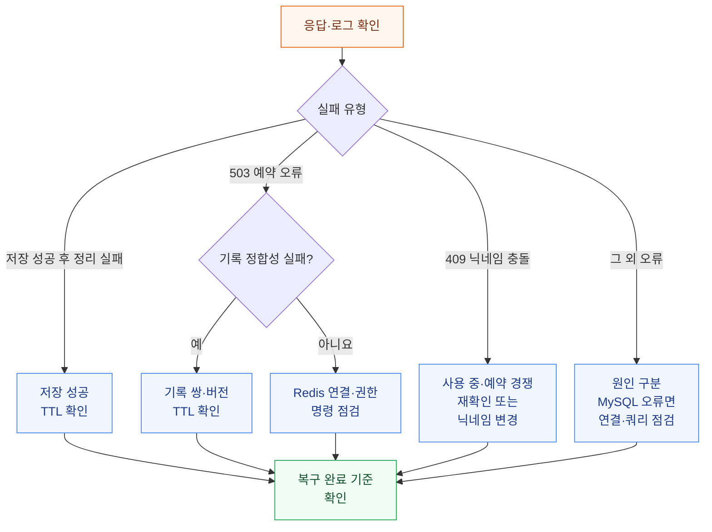

# 닉네임 예약 운영 Runbook

- Status: Active
- Audience: Backend Engineers, Operators
- Source of Truth: Yes
- Last Reviewed: 2026-10-15

## 목적

공유 닉네임 예약의 운영 상태를 확인하고 Redis 장애·기록 손상, 저장 충돌과 커밋 후 정리 실패에 대응한다.

## 운영 점검

- 가입 예약과 프로필 점유를 처리하는 모든 인스턴스가 같은 Redis 예약 저장소에 연결되는지 확인한다.
- 예약 네임스페이스는 `nickname-reservations:v1:{nickname-holds-v1}:`이다.
- 예약은 최초 생성부터 10분 후 만료된다. 동일 예약 재요청 시 만료 시각이 유지되고, 만료된 기록이 소멸하는지 확인한다.

## 관측 신호

| 로그 event | 의미 |
| --- | --- |
| `nickname_reservation` + `outcome=unavailable` | 요청 중 예약 저장소 접근 또는 기록 정합성 실패 |
| `signup_nickname_reservation_cleanup` + `outcome=failed` | 가입 저장 성공 후 예약 정리 실패 |
| `profile_nickname_reservation_cleanup` + `outcome=failed` | 프로필 저장 성공 후 점유 정리 실패 |

예약 저장소 실패의 `stage`는 `reservation_read`, `reservation_write`, `reservation_consistency`, `reservation_cleanup`으로 구분한다. `errorType`으로 예외 종류를 확인한다.

## 장애 대응 흐름

## Redis 연결·명령 장애

1. 응답이 503, `code`가 `NICKNAME_RESERVATION_UNAVAILABLE`인지 확인하고 로그의 `stage`·`errorType`을 확인한다.
2. Redis 연결 대상, 네임스페이스 접근 권한과 명령 실행 가능 여부를 점검한다. `reservation_consistency`라면 예약 기록 손상 절차를 따른다.
3. 복구 상태를 확인하며 간격을 두고 재시도한다.
4. 복구 후 503이 해소되고 인스턴스 간 예약이 공유되는지 확인한다.

## 예약 기록 손상

1. `reservation_consistency`와 503을 확인하고 정상 예약 경쟁인 409와 구분한다.
2. 영향받은 닉네임·소유자 기록의 존재 여부, 필수 필드, 소유자·닉네임 비교 키·예약 버전의 일치 여부와 남은 TTL을 확인한다.
3. 유효한 TTL이 있으면 자연 만료 후 재예약을 확인한다. TTL이 없거나 손상이 반복되면 원인을 조사하고 복구한다.
4. 수동 조치가 필요하면 현재 소유자·닉네임 비교 키·예약 버전을 함께 검증해 다른 소유자나 새 예약을 보존한다.

## 충돌 증가 또는 MySQL 장애

1. 409 닉네임 충돌, Redis 예약 저장소 503과 MySQL 연결·쿼리 오류를 구분한다.
2. 409라면 이미 사용 중인 닉네임, 타인의 유효 예약 또는 최종 저장 경쟁인지 확인한다. 사용 가능 여부를 다시 확인하거나 다른 닉네임을 선택한다.
3. MySQL 오류라면 연결·쿼리 실행, `users.nickname` UNIQUE 제약과 `utf8mb4_0900_ai_ci` collation을 점검한다. MySQL은 예약 비교 키 생성에도 사용된다.

## 커밋 후 정리 실패

1. 정리 실패 event와 `errorType`을 확인하고 가입·프로필 저장 성공 여부를 확인한다. 이미 완료된 가입·변경 요청을 다시 실행하지 않는다.
2. 남은 예약이 원래 TTL에 따라 만료 후 소멸하는지 확인한다.
3. 수동 정리가 필요하면 현재 소유자·닉네임 비교 키·예약 버전이 모두 일치하는 기록만 대상으로 한다.

## 복구 완료 기준

- 인스턴스 간 예약이 공유되고 예약 저장소 503이 해소된다.
- 동일 예약 재요청에서 만료 시각이 유지되고, 남은 기록이 TTL에 따라 소멸한다.
- 정상 닉네임 충돌은 409로 구분되며 다른 소유자나 새 버전의 예약이 보존된다.
